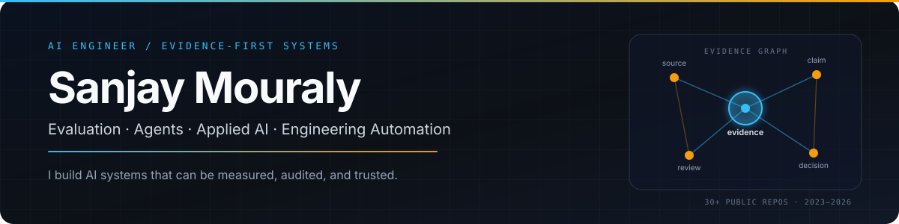

<div align="center">
  
</div>

<div align="center">

[](https://github.com/sanjaymouraly)
[](#what-i-work-on)
[](https://github.com/sanjaymouraly/agentevalops-platform)

</div>

<div align="center">


</div>

### I build AI systems that can be measured, audited, and trusted.

Most AI projects stop at the demo. I build the layer that makes them usable: evaluation harnesses, evidence trails, human review loops, and interfaces for engineering and operations.

I care about systems that are **measurable**, **auditable**, and **useful** — not just impressive in a notebook.

## What I work on

<table>
<tr>
<td width="50%" valign="top">

#### 🧪 AI evaluation
Agent benchmarks, calibration, inter-rater agreement, regression gates, drift.

</td>
<td width="50%" valign="top">

#### 🧩 Applied AI
RAG over engineering documents, document extraction, SOP compliance, supplier risk.

</td>
</tr>
<tr>
<td width="50%" valign="top">

#### ⚙️ Automation
Excel and report pipelines, data cleaning, API reliability, log analysis.

</td>
<td width="50%" valign="top">

#### 🧭 Decision systems
Evidence graphs, launch-risk twins, procurement exceptions, production scheduling.

</td>
</tr>
</table>

## How I think about AI systems

<div align="center">

`Sources` → `Retrieve + claims` → `Evidence` → `Human review` → `Decision`

</div>

The goal is not just an answer. It is an answer that can be traced, challenged, and improved.

## Selected systems

<table>
<tr>
<td width="50%" valign="top">

#### 🧪 AgentEvalOps
**Continuous agent qualification.**
Versioned benchmarks, isolated trials, pass@k, McNemar, and drift signals.
`Python` `FastAPI` `React` `Docker`

[Explore →](https://github.com/sanjaymouraly/agentevalops-platform)

</td>
<td width="50%" valign="top">

#### 🧭 Mini SWE-Bench
**Bug-repair evaluation.**
Isolated grading, anti-tampering checks, and 12 reproducible repos.
`Python` `Docker` `pytest`

[Explore →](https://github.com/sanjaymouraly/mini-swe-bench-bug-repair)

</td>
</tr>
<tr>
<td width="50%" valign="top">

#### 🏭 AI SOP Compliance Checker
**Evidence-first manufacturing audits.**
Quote-level verification, RBAC, and conflict detection.
`FastAPI` `React` `LLM adapters`

[Explore →](https://github.com/sanjaymouraly/ai-manufacturing-sop-compliance-checker)

</td>
<td width="50%" valign="top">

#### 📡 RAG Evaluation Monitor
**Quality regression and drift.**
Retrieval, answers, citations, latency, and cost tracked together.
`Python` `Streamlit` `RAG`

[Explore →](https://github.com/sanjaymouraly/rag-evaluation-drift-monitor)

</td>
</tr>
<tr>
<td width="50%" valign="top">

#### 🛰️ NPI Launch Risk Twin
**Decision intelligence for launches.**
CPM, CP-SAT, Monte Carlo, and paired scenario comparison.
`FastAPI` `OR-Tools` `React`

[Explore →](https://github.com/sanjaymouraly/npi-launch-risk-digital-twin)

</td>
<td width="50%" valign="top">

#### 🕸️ Evidence-Graph Auditor
**Trace decisions to evidence.**
Typed evidence spans, conflict surfacing, and auditable gates.
`Python` `FastAPI` `LLM`

[Explore →](https://github.com/sanjaymouraly/evidence-graph-ai-auditor)

</td>
</tr>
</table>

> New here? Start with **AgentEvalOps** for evaluation, **NPI Launch Risk Twin** for decision intelligence, or **Smart File Organizer** for practical automation.

## Operating principles

1. **Measure the claim.** If it cannot be evaluated, it is still a demo.
2. **Show the evidence.** Every decision should trace back to a source.
3. **Keep humans in the loop.** Automation handles scale; people handle judgment.
4. **Make it local-first.** Reproducible, privacy-aware, and usable offline.

## Build timeline

| Year | Theme | Representative work |
|---|---|---|
| **2023** | Python, automation, first AI experiments | Formula solver, Excel reports, API monitor, prompt lab |
| **2024** | Applied AI, LLMs, ML | RAG assistant, formula validator, defect detection, supplier risk |
| **2025** | Agents, optimization, benchmarking | Tool-calling agent, RAG drift monitor, SOP audits, CP-SAT scheduling |
| **2026** | Advanced benchmarks and agent systems | Mini SWE-Bench, multimodal verification, evidence graphs, AgentEvalOps |

## Toolbox

<div align="center">


<br/><br/>


</div>

## Currently

```text
$ whoami
sanjay mouraly

$ focus
evaluation-first ai systems · agents · applied automation

$ building
AgentEvalOps — continuous qualification for AI agents
```

## Connect

The best way to reach me is here on GitHub — open an issue or start a discussion on any repository.

<div align="center">

[](https://github.com/sanjaymouraly)

**36 public repositories · 2023–2026 · built with Python, Markdown, and a bias toward evidence.**

</div>
